# BOQ Variation Order - Discovery & Dependency Map

## Executive Overview

`BOQ Variation Order` manages variations against a baseline `BOQ` (Bill of Quantities) in Fabrica Construction. It supports three distinct operational flows:
1. **Update Current BOQ**: Modifies quantities, rates, or allocations of existing BOQ items, with support for removing rows (qty = 0).
2. **Add New Scope**: Introduces new items/categories or adds additional scope to existing items.
3. **Update Zero Qty Items**: Re-activates zero-quantity items previously archived or imported as inactive into active BOQ allocations.

Downstream in `Aljar System`, the controller and client behavior are subclassed/overridden to handle legacy BOQ structures (`custom_old_data`), custom allocation rules, and contracted quantity validations.

---

## 1. DocType Metadata & Schema

- **DocType Definition**: [`boq_variation_order.json`](file:///home/ahmed-khairy/Documents/Projects/Fabrica_Project/frappe-bench/apps/fabrica_construction/fabrica_construction/fabrica_construction/doctype/boq_variation_order/boq_variation_order.json#L1-L284)
- **Module**: `Fabrica Construction`
- **Submittable**: Yes (`is_submittable = 1`)
- **Engine**: `InnoDB`
- **Track Changes**: `track_changes = 1`, `track_seen = 1`, `track_views = 1`
- **Naming**: Standard Frappe hash/series (submittable, `amended_from` link present)
- **Key Fields**:
  - `boq` (`Link` to `BOQ`, required, read-only).
  - `variation_order_flow_type` (`Select`: `Update Current BOQ`, `Add New Scope`, `Update Zero Qty Items`, required, read-only).
  - `company` (`Link` to `Company`, required, read-only, in list view, standard filter).
  - `project` (`Link` to `Project`, read-only, in global search, list view, standard filter).
  - `date` (`Date`, default `Today`, in list view).
  - `zone` (`Link` to `Zone`, read-only).
  - `total_amount` (`Currency`, read-only).
  - `use_items_resources_in_boq` (`Check`, hidden, read-only).
  - `has_attachment` (`Check`, read-only).
  - **Child Tables**:
    - `bill_of_quantity` (`Table` of `BOQ Variation Order Items`).
    - `boq_items_resources` (`Table` of `BOQ Items Resources`, read-only preview).
  - **Multiselect Filter Controls** (used for dynamic item population in `Add New Scope`):
    - `construction_zone`, `building_type`, `building`, `floor`, `garage`, `units`, `scope`, `work_type`, `construction_items`, `construction_items_resources`.
  - **Action Buttons**: `get_items`, `clear_all_filters`.
- **Permissions**: `System Manager` (Read, Write, Create, Delete, Submit, Cancel/Amend via standard docstatus flow).

---

## 2. Python Controllers & Inheritance Hierarchy

### A. Base Construction Controller
- **File**: [`boq_variation_order.py`](file:///home/ahmed-khairy/Documents/Projects/Fabrica_Project/frappe-bench/apps/fabrica_construction/fabrica_construction/fabrica_construction/doctype/boq_variation_order/boq_variation_order.py#L45-L963)
- **Class**: `BOQVariationOrder(BOQ)` — inherits from `BOQ`.
- **Lifecycle Methods Implemented**:
  - `before_insert()` [L108-L112]: validates no open quantity mismatch on source BOQ via `validate_no_open_boq_quantity_mismatch()`, calls `super().before_insert()`.
  - `before_validate()` [L160-L164]: calls `self.get_flow().before_validate()`, then `super().before_validate()`.
  - `validate()` [L295-L302]: calls `super().validate()`, blocks save if draft VOs exist for the same BOQ (`check_if_there_any_draft_boq_vos(raise_exception=True)`), validates flow type immutability, delegates to `self.get_flow().validate()`, validates child projects match parent, checks BOQ child uniqueness in table.
  - `before_submit()` [L365-L368]: calls `super().before_submit()`, delegates to `self.get_flow().before_submit()`.
  - `on_submit()` [L361-L364]: delegates to `self.get_flow().on_submit()`, calls `self._boq_doc.refresh_boq_variation_order_delete_records_flag()`.
  - `on_cancel()` [L546-L550]: marks `ignore_linked_doctypes = ("BOQ Variation Order Logs",)`, calls `self.get_flow().on_cancel()`.
- **Flow Engine Decomposition**:
  - Factory: [`factory.py`](file:///home/ahmed-khairy/Documents/Projects/Fabrica_Project/frappe-bench/apps/fabrica_construction/fabrica_construction/fabrica_construction/doctype/boq_variation_order/flows/factory.py#L16-L29) (`get_boq_variation_order_flow`).
  - Base Flow: [`base.py`](file:///home/ahmed-khairy/Documents/Projects/Fabrica_Project/frappe-bench/apps/fabrica_construction/fabrica_construction/fabrica_construction/doctype/boq_variation_order/flows/base.py#L24-L90) (`BOQVariationOrderFlow`).
  - Flows:
    - [`add_new_scope.py`](file:///home/ahmed-khairy/Documents/Projects/Fabrica_Project/frappe-bench/apps/fabrica_construction/fabrica_construction/fabrica_construction/doctype/boq_variation_order/flows/add_new_scope.py#L12-L226) (`AddNewScopeFlow`).
    - [`update_current_boq.py`](file:///home/ahmed-khairy/Documents/Projects/Fabrica_Project/frappe-bench/apps/fabrica_construction/fabrica_construction/fabrica_construction/doctype/boq_variation_order/flows/update_current_boq.py#L12-L161) (`UpdateCurrentBOQFlow`).
    - [`update_zero_qty_items.py`](file:///home/ahmed-khairy/Documents/Projects/Fabrica_Project/frappe-bench/apps/fabrica_construction/fabrica_construction/fabrica_construction/doctype/boq_variation_order/flows/update_zero_qty_items.py#L37-L224) (`UpdateZeroQtyItemsFlow`).
- **Whitelisted Methods**:
  - `get_unchanged_update_current_boq_rows()` [L829-L870].
  - `validate_uploaded_data_update_current(data)` [L884-L922].
  - `export_locked_items(template)` [L957-L962].

### B. Downstream App Override (Aljar System)
- **Hook**: [`aljar_system/hooks.py:172`](file:///home/ahmed-khairy/Documents/Projects/Fabrica_Project/frappe-bench/apps/aljar_system/aljar_system/hooks.py#L172) -> `override_doctype_class["BOQ Variation Order"] = "aljar_system.override.boq_variation_order.AljarBOQVariationOrder"`.
- **Controller**: [`aljar_system/override/boq_variation_order.py`](file:///home/ahmed-khairy/Documents/Projects/Fabrica_Project/frappe-bench/apps/aljar_system/aljar_system/override/boq_variation_order.py#L14-L63).
- **Behavior Interception**:
  - `boq_vaidate_system_structure_hierarchy()`: bypasses standard validation if `custom_old_data` is set on the BOQ and delegates to `AljarOldBOQHierarchyValidation`.
  - `before_validate()` & `before_submit()`: invokes `self.bypass_validations_for_old_data()` before calling `super()`.
  - `_validate_non_negative()`: validates that `contracted_qty` cannot be negative on child rows, with an exemption for `Update Current BOQ` on old data BOQs.

---

## 3. Child DocTypes & Related Entities

1. **`BOQ Variation Order Items`**:
   - Schema: [`boq_variation_order_items.json`](file:///home/ahmed-khairy/Documents/Projects/Fabrica_Project/frappe-bench/apps/fabrica_construction/fabrica_construction/fabrica_construction/doctype/boq_variation_order_items/boq_variation_order_items.json#L1-L665).
   - Controller: [`boq_variation_order_items.py`](file:///home/ahmed-khairy/Documents/Projects/Fabrica_Project/frappe-bench/apps/fabrica_construction/fabrica_construction/fabrica_construction/doctype/boq_variation_order_items/boq_variation_order_items.py#L1-L87).
   - Property Setters (Aljar): [`boq_variation_order_items.json`](file:///home/ahmed-khairy/Documents/Projects/Fabrica_Project/frappe-bench/apps/aljar_system/aljar_system/aljar_system/custom/boq_variation_order_items.json#L4-L97) (e.g. non_negative contracted_qty disabled, fetch_from for construction_item_code).
2. **`BOQ Items Resources`**:
   - Preview child table populated dynamically during save/validate when `use_items_resources_in_boq = 1`.
3. **`BOQ Variation Order Logs`**:
   - Schema: [`boq_variation_order_logs.json`](file:///home/ahmed-khairy/Documents/Projects/Fabrica_Project/frappe-bench/apps/fabrica_construction/fabrica_construction/fabrica_construction/doctype/boq_variation_order_logs/boq_variation_order_logs.json#L1-L157).
   - Controller: [`boq_variation_order_logs.py`](file:///home/ahmed-khairy/Documents/Projects/Fabrica_Project/frappe-bench/apps/fabrica_construction/fabrica_construction/fabrica_construction/doctype/boq_variation_order_logs/boq_variation_order_logs.py#L8-L41).
   - Serves as the audit trail and rollback store (`boq_child_data`, `boq_child_resources_data`, `zero_qty_movement`) used when cancelling variation orders.

---

## 4. Client Scripts & UI Hooks

1. **Core Form Script**:
   - [`boq_variation_order.js`](file:///home/ahmed-khairy/Documents/Projects/Fabrica_Project/frappe-bench/apps/fabrica_construction/fabrica_construction/fabrica_construction/doctype/boq_variation_order/boq_variation_order.js#L1-L1413).
   - Handlers: `setup`, `refresh`, `before_submit`, `before_workflow_action`, `get_items`, `clear_all_filters`, `variation_order_flow_type`, `apply_flow_type_ui`.
   - Grid overrides: Download/Upload excel sheet buttons (`override_download_button`, `override_upload_button`).
   - Warning dialogs on submit: Zero-quantity confirmation, unchanged rows removal prompt.
2. **Override Form Script (Aljar)**:
   - Hook: [`aljar_system/hooks.py:78-81`](file:///home/ahmed-khairy/Documents/Projects/Fabrica_Project/frappe-bench/apps/aljar_system/aljar_system/hooks.py#L78-L81) -> `doctype_js["BOQ Variation Order"] = ["public/js/boq_variation_order.js"]`.
   - Script: [`aljar_system/public/js/boq_variation_order.js`](file:///home/ahmed-khairy/Documents/Projects/Fabrica_Project/frappe-bench/apps/aljar_system/aljar_system/public/js/boq_variation_order.js#L3-L22).
   - Handlers: Replaces `require_building_for_floor` and `update_item_type_of_allocations_mandotry`, binds `onload`, `boq`, and `refresh` to load legacy BOQ metadata.

---

## 5. System Hooks & Cascade Listeners

- **Global doc_events in `fabrica_construction/hooks.py`**:
  - `BOQ.on_change` -> [`on_boq_change`](file:///home/ahmed-khairy/Documents/Projects/Fabrica_Project/frappe-bench/apps/fabrica_construction/fabrica_construction/doc_events/boq.py#L13-L14): triggers `recalculate_item_resource_boq_quantities(doc.name)`.
  - `BOQ Child.on_change` -> [`on_boq_child_change`](file:///home/ahmed-khairy/Documents/Projects/Fabrica_Project/frappe-bench/apps/fabrica_construction/fabrica_construction/doc_events/boq.py#L17-L19): triggers `recalculate_item_resource_boq_quantities(doc.parent)`.
  - `BOQ Items Resources.on_change` -> [`on_boq_items_resources_change`](file:///home/ahmed-khairy/Documents/Projects/Fabrica_Project/frappe-bench/apps/fabrica_construction/fabrica_construction/doc_events/boq.py#L22-L24): triggers `recalculate_item_resource_boq_quantities(doc.parent)`.
  - `*` (`on_change`, `before_insert`): [`save_custom_version_for_doctype`](file:///home/ahmed-khairy/Documents/Projects/Fabrica_Project/frappe-bench/apps/fabrica_construction/fabrica_construction/utils/data.py#L650) and [`set_custom_allocated_qty`](file:///home/ahmed-khairy/Documents/Projects/Fabrica_Project/frappe-bench/apps/fabrica_construction/fabrica_construction/utils/data.py#L750).

---

## 6. Service Layer & External Touchpoints

- **Service Module**: [`services/boq/variation_order.py`](file:///home/ahmed-khairy/Documents/Projects/Fabrica_Project/frappe-bench/apps/fabrica_construction/fabrica_construction/services/boq/variation_order.py#L1-L293).
  - Background Job Queueing: `create_boq_variation_order_with_queue` enqueues large mappings to queue `save_construction_docs` if mapped row count > threshold configured in `Construction Settings`.
  - File Locking: Uses `filelock(f"create_boq_variation_order_{lock_key}")` during background VO creation.
  - Inter-document links:
    - `BOQ` links to `BOQ Variation Order` via Dashboard [`boq_dashboard.py:15`](file:///home/ahmed-khairy/Documents/Projects/Fabrica_Project/frappe-bench/apps/fabrica_construction/fabrica_construction/fabrica_construction/doctype/boq/boq_dashboard.py#L15).
    - `Construction Item` dashboard links to it [`construction_item_dashboard.py:17`](file:///home/ahmed-khairy/Documents/Projects/Fabrica_Project/frappe-bench/apps/fabrica_construction/fabrica_construction/fabrica_construction/doctype/construction_item/construction_item_dashboard.py#L17).
    - `Construction Export Template` fixture [`construction_export_template.json`](file:///home/ahmed-khairy/Documents/Projects/Fabrica_Project/frappe-bench/apps/fabrica_construction/fabrica_construction/fixtures/construction_export_template.json#L88-L96).
    - `Construction Workspace` links to it [`construction.json`](file:///home/ahmed-khairy/Documents/Projects/Fabrica_Project/frappe-bench/apps/fabrica_construction/fabrica_construction/fabrica_construction/workspace/construction/construction.json#L77).

---

## 7. Patches & Historical Migrations

- [`fabrica_construction/patches/v0_0_3/backfill_boq_variation_order_flow_type.py`](file:///home/ahmed-khairy/Documents/Projects/Fabrica_Project/frappe-bench/apps/fabrica_construction/fabrica_construction/patches/v0_0_3/backfill_boq_variation_order_flow_type.py#L7-L22): backfills empty flow types prior to `2026-06-22` as `Update Current BOQ`.
- [`aljar_system/patches/clean_boq_variation_order/clean_boq_variation_order.py`](file:///home/ahmed-khairy/Documents/Projects/Fabrica_Project/frappe-bench/apps/aljar_system/aljar_system/patches/clean_boq_variation_order/clean_boq_variation_order.py#L28-L64): one-off data remediation patch to delete erroneous items from an Excel manifest without triggering lifecycle cascades.
- [`aljar_system/patches/v0_0_6/backfill_missing_work_type_from_item_code_boq.py`](file:///home/ahmed-khairy/Documents/Projects/Fabrica_Project/frappe-bench/apps/aljar_system/aljar_system/patches/v0_0_6/backfill_missing_work_type_from_item_code_boq.py#L13).

---

## 8. Test Suite Footprint

- Unit tests: [`test_boq_variation_order.py`](file:///home/ahmed-khairy/Documents/Projects/Fabrica_Project/frappe-bench/apps/fabrica_construction/fabrica_construction/fabrica_construction/doctype/boq_variation_order/test_boq_variation_order.py#L64-L308) (12 test cases covering mismatch validation, rate preview, allocation matching).
- Resource restoration tests: [`test_boq_variation_order_resource_restoration.py`](file:///home/ahmed-khairy/Documents/Projects/Fabrica_Project/frappe-bench/apps/fabrica_construction/fabrica_construction/fabrica_construction/doctype/boq_variation_order/test_boq_variation_order_resource_restoration.py#L63-L179) (3 test cases covering cancellation log reversal).
- Service tests: [`tests/boq/test_vo_service.py`](file:///home/ahmed-khairy/Documents/Projects/Fabrica_Project/frappe-bench/apps/fabrica_construction/fabrica_construction/tests/boq/test_vo_service.py#L1-L260).
- Downstream override tests: [`aljar_system/override/test_old_boq_hierarchy_validation.py`](file:///home/ahmed-khairy/Documents/Projects/Fabrica_Project/frappe-bench/apps/aljar_system/aljar_system/override/test_old_boq_hierarchy_validation.py#L74-L138).

---

## 9. Dependency Map: Lifecycle Execution & Cascading Side Effects

```mermaid
flowchart TD
    subgraph UI_Client ["Client Side (boq_variation_order.js)"]
        FormLoad["Form Load / Refresh"] --> FlowPrompt["Prompt Flow Type (if new)"]
        FlowPrompt --> ChildUI["apply_child_table_flow_ui()<br/>Row-level field locks & observers"]
        SubmitClick["Submit Click"] --> ConfirmChecks{"Check Zero Qty / Unchanged Rows"}
        ConfirmChecks -->|Cancel| AbortSubmit["Abort Submit"]
        ConfirmChecks -->|Confirm| SaveBeforeSubmit["Save (strip unchanged) -> Trigger Submit"]
    end

    subgraph Doc_Validation ["Server: Validate Cycle"]
        BInsert["before_insert()"] --> MismatchCheck["validate_no_open_boq_quantity_mismatch()<br/>Checks all BOQ Child sources"]
        BValidate["before_validate()"] --> FlowBValidate["Flow.before_validate()<br/>Preview resource sync"]
        Validate["validate()"] --> DraftCheck["check_if_there_any_draft_boq_vos()<br/>(Blocks concurrent draft VOs)"]
        DraftCheck --> FlowValidate["Flow.validate()<br/>Child validation, hierarchy & allocation checks"]
        FlowValidate --> DupeCheck["validate_boq_child_unique()"]
    end

    subgraph Doc_Submit ["Server: Submit Cycle (back_update_boq_for_submit)"]
        BSubmit["before_submit()"] --> LockCheck["Check negative qty & read-only fields"]
        Submit["on_submit()"] --> LoadBOQ["Load parent BOQ (_boq_doc)"]
        
        LoadBOQ --> LoopRows["Iterate bill_of_quantity rows"]
        LoopRows -->|Existing Row| UpdateChild["_update_boq_child_item()<br/>- If qty==0: delete child & resources<br/>- Else: update child qty/rate"]
        LoopRows -->|New Row| InsertChild["_insert_new_boq_child_item()<br/>- new_boq_child.save() [PER ROW]"]
        
        UpdateChild --> LogInsert1["insert_new_variation_order_log_for_update_boq()<br/>-> Creates & SUBMITS BOQ Variation Order Logs [PER ROW]"]
        InsertChild --> LogInsert2["insert_new_variation_order_log_for_update_boq()<br/>-> Creates & SUBMITS BOQ Variation Order Logs [PER ROW]"]

        InsertChild -.->|Triggers Hook| ChildOnChange["doc_events: BOQ Child on_change<br/>recalculate_item_resource_boq_quantities()"]
        
        LogInsert1 --> BOQSave1["_boq_doc.save()<br/>(Saves parent BOQ)"]
        LogInsert2 --> BOQSave1

        BOQSave1 --> RecalcResources["recalculate_boq_item_resources()<br/>+ boq_doc.set_rate_for_items()<br/>+ boq_doc.system_updates()"]
        RecalcResources --> BOQSave2["_boq_doc.save() [SECOND SAVE]"]
        BOQSave2 --> RefreshFlag["refresh_boq_variation_order_delete_records_flag()"]
    end

    subgraph Doc_Cancel ["Server: Cancel Cycle (back_update_boq_for_cancel)"]
        Cancel["on_cancel()"] --> CancelFlow["Flow.apply_cancel()"]
        CancelFlow --> ReadLogs["Query active BOQ Variation Order Logs"]
        ReadLogs --> RestoreDoc["Restore child row / resources from stored JSON snapshot"]
        RestoreDoc --> MarkLogCancel["Set log.cancelled = 1 and save log"]
        MarkLogCancel --> SaveBOQCancel["_boq_doc.save() + recalculate_boq_item_resources()"]
    end
```

---

## 10. Key Structural & Architectural Friction Points Identified

1. **Severe N+1 and Multi-Document Insertion in Submit Loop**:
   - In [`boq_variation_order.py:475-517`](file:///home/ahmed-khairy/Documents/Projects/Fabrica_Project/frappe-bench/apps/fabrica_construction/fabrica_construction/fabrica_construction/doctype/boq_variation_order/boq_variation_order.py#L475-L517), `_insert_new_boq_child_item` calls `new_boq_child.save()` on every single row.
   - In [`boq_variation_order.py:1073-1093`](file:///home/ahmed-khairy/Documents/Projects/Fabrica_Project/frappe-bench/apps/fabrica_construction/fabrica_construction/fabrica_construction/doctype/boq_variation_order/boq_variation_order.py#L1073-L1093) & [`boq_variation_order_logs.py:34-41`](file:///home/ahmed-khairy/Documents/Projects/Fabrica_Project/frappe-bench/apps/fabrica_construction/fabrica_construction/fabrica_construction/doctype/boq_variation_order_logs/boq_variation_order_logs.py#L34-L41), for *every child row*, an independent `BOQ Variation Order Logs` submittable document is instantiated and submitted (`boq_variation_order_log.submit()`). For 1,000 rows, this executes 1,000 individual insert/submit transactions.
2. **Hook Storm on BOQ Save**:
   - `BOQ Child.save()` triggers `on_change` in `doc_events` ([`hooks.py:180-182`](file:///home/ahmed-khairy/Documents/Projects/Fabrica_Project/frappe-bench/apps/fabrica_construction/fabrica_construction/hooks.py#L180-L182) -> [`doc_events/boq.py:17-19`](file:///home/ahmed-khairy/Documents/Projects/Fabrica_Project/frappe-bench/apps/fabrica_construction/fabrica_construction/doc_events/boq.py#L17-L19)), causing `recalculate_item_resource_boq_quantities(doc.parent)` to fire repeatedly per row, followed by multiple `_boq_doc.save()` calls in the parent.
3. **Loop-level Document Loads in Flow Validation**:
   - In [`update_current_boq.py:153-159`](file:///home/ahmed-khairy/Documents/Projects/Fabrica_Project/frappe-bench/apps/fabrica_construction/fabrica_construction/fabrica_construction/doctype/boq_variation_order/flows/update_current_boq.py#L153-L159), `_get_boq_children()` iterates through all rows and executes `frappe.get_doc("BOQ Child", name)` individually instead of a single batched query.
