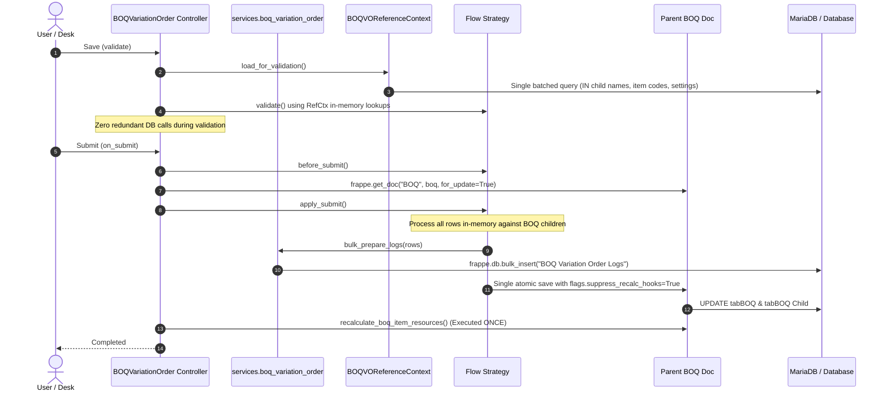

# Comprehensive Refactoring Plan: BOQ Variation Order

## 1. Executive Summary: Top 5 Issues by Impact

1. **Per-Row Submittable Document Creation & Submission (Critical Performance Bottleneck)**:
   During submit, [`insert_new_variation_order_log_for_update_boq`](file:///home/ahmed-khairy/Documents/Projects/Fabrica_Project/frappe-bench/apps/fabrica_construction/fabrica_construction/fabrica_construction/doctype/boq_variation_order/boq_variation_order.py#L1073-L1093) calls [`create_boq_variation_order_logs`](file:///home/ahmed-khairy/Documents/Projects/Fabrica_Project/frappe-bench/apps/fabrica_construction/fabrica_construction/fabrica_construction/doctype/boq_variation_order_logs/boq_variation_order_logs.py#L34-L41), creating and **submitting** an independent `BOQ Variation Order Logs` document per row. For a 1,000-row VO, this executes 1,000 full document insertions, autonaming, validations, and submittable state updates in individual transactions.
2. **Hook Storms & Redundant Parent BOQ Saves**:
   In [`back_update_boq_for_submit`](file:///home/ahmed-khairy/Documents/Projects/Fabrica_Project/frappe-bench/apps/fabrica_construction/fabrica_construction/fabrica_construction/doctype/boq_variation_order/boq_variation_order.py#L370-L393), new child items execute `new_boq_child.save()`, which triggers [`doc_events["BOQ Child"]["on_change"]`](file:///home/ahmed-khairy/Documents/Projects/Fabrica_Project/frappe-bench/apps/fabrica_construction/fabrica_construction/hooks.py#L180-L182) to recalculate resources on the parent BOQ repeatedly. The parent `_boq_doc.save()` is then executed up to **3 separate times** within a single submit cycle.
3. **Severe N+1 Document Hydration in Validation Loops**:
   [`UpdateCurrentBOQFlow._get_boq_children()`](file:///home/ahmed-khairy/Documents/Projects/Fabrica_Project/frappe-bench/apps/fabrica_construction/fabrica_construction/fabrica_construction/doctype/boq_variation_order/flows/update_current_boq.py#L153-L159) and [`_validate_uploaded_update_current_boq_child_qty`](file:///home/ahmed-khairy/Documents/Projects/Fabrica_Project/frappe-bench/apps/fabrica_construction/fabrica_construction/fabrica_construction/doctype/boq_variation_order/boq_variation_order.py#L950) call `frappe.get_doc("BOQ Child", name)` inside a loop over every row instead of a single batched read, needlessly hydrating child tables and properties.
4. **Un-batched Cancellation & Log Query Storm**:
   During `on_cancel()` ([`boq_variation_order.py:551-570`](file:///home/ahmed-khairy/Documents/Projects/Fabrica_Project/frappe-bench/apps/fabrica_construction/fabrica_construction/fabrica_construction/doctype/boq_variation_order/boq_variation_order.py#L551-L570)), each row executes `frappe.get_all(...)` to locate its active log, calls `frappe.get_doc(...)`, and updates the log with `save()`. For 500 rows, this generates over 1,500 database operations.
5. **Monolithic Fat Controller Violating Locality & Depth**:
   [`boq_variation_order.py`](file:///home/ahmed-khairy/Documents/Projects/Fabrica_Project/frappe-bench/apps/fabrica_construction/fabrica_construction/fabrica_construction/doctype/boq_variation_order/boq_variation_order.py) spans 1,093 lines mixing lifecycle orchestration, raw JSON parsing, Excel row normalization, DOM/HTML formatting, and mathematical resource formulas. Unlike `BOQ` which was modularized into `services/boq/`, `boq_variation_order` lacks a dedicated service layer and batch-loading reference context.

---

## 2. Architecture Map: Proposed Component Structure

Following the pattern proven in `services/boq/`, domain responsibilities will be separated into a deep service package:

```
fabrica_construction/
└── services/
    └── boq_variation_order/
        ├── __init__.py                # Clean interface & public function re-exports
        ├── reference_context.py       # BOQVOReferenceContext (batch-loads BOQ Child, Items, Settings)
        ├── calculations.py            # Resource math, qty formulas, and amount totals
        ├── validation.py              # BOQVOValidationService (unique checks, project matching, upload rules)
        ├── logs.py                    # Batched logging engine (bulk-insert & bulk-cancel of VO logs)
        └── flows/                     # Flow strategy pattern (relocated from doctype folder)
            ├── base.py
            ├── factory.py
            ├── add_new_scope.py
            ├── update_current_boq.py
            └── update_zero_qty_items.py
```

### Component & Event Lifecycle Interaction



---

## 3. Findings Table

| ID | Title | Category | Severity | Evidence | Expected Impact | Recommended Fix | Risk / Effort | Migration |
| :--- | :--- | :--- | :--- | :--- | :--- | :--- | :--- | :--- |
| **F-01** | Submittable Log creation per child row | Performance | **Critical** | [`boq_variation_order.py:1082-1093`](file:///home/ahmed-khairy/Documents/Projects/Fabrica_Project/frappe-bench/apps/fabrica_construction/fabrica_construction/fabrica_construction/doctype/boq_variation_order/boq_variation_order.py#L1082-L1093), [`boq_variation_order_logs.py:34-41`](file:///home/ahmed-khairy/Documents/Projects/Fabrica_Project/frappe-bench/apps/fabrica_construction/fabrica_construction/fabrica_construction/doctype/boq_variation_order_logs/boq_variation_order_logs.py#L34-L41) | For $N$ rows: $N$ inserts + $N$ submits = $2N$ queries + triggers. (500 rows = 1,000 queries) | Buffer log dictionaries in memory and execute a single `frappe.db.bulk_insert`. | Medium / **M** | No |
| **F-02** | `new_boq_child.save()` in submit loop | Performance / Correctness | **Critical** | [`boq_variation_order.py:507`](file:///home/ahmed-khairy/Documents/Projects/Fabrica_Project/frappe-bench/apps/fabrica_construction/fabrica_construction/fabrica_construction/doctype/boq_variation_order/boq_variation_order.py#L507) | Triggers `doc_events["BOQ Child"]["on_change"]` per row, causing full resource recalculation on parent BOQ $N$ times. | Append children to `_boq_doc.bill_of_quantity` in-memory and save the parent document once at the end. | Medium / **M** | No |
| **F-03** | Multiple redundant parent `_boq_doc.save()` calls on submit | Performance | **High** | [`boq_variation_order.py:393`](file:///home/ahmed-khairy/Documents/Projects/Fabrica_Project/frappe-bench/apps/fabrica_construction/fabrica_construction/fabrica_construction/doctype/boq_variation_order/boq_variation_order.py#L393), [`add_new_scope.py:37`](file:///home/ahmed-khairy/Documents/Projects/Fabrica_Project/frappe-bench/apps/fabrica_construction/fabrica_construction/fabrica_construction/doctype/boq_variation_order/flows/add_new_scope.py#L37), [`update_zero_qty_items.py:73,80`](file:///home/ahmed-khairy/Documents/Projects/Fabrica_Project/frappe-bench/apps/fabrica_construction/fabrica_construction/fabrica_construction/doctype/boq_variation_order/flows/update_zero_qty_items.py#L73) | Up to 3 full parent document writes and validations per submit, each locking the BOQ. | Consolidate updates (items, rates, system updates) so parent BOQ is saved exactly **once**. | Low / **S** | No |
| **F-04** | N+1 `frappe.get_doc("BOQ Child")` in validation | Performance | **High** | [`update_current_boq.py:155-158`](file:///home/ahmed-khairy/Documents/Projects/Fabrica_Project/frappe-bench/apps/fabrica_construction/fabrica_construction/fabrica_construction/doctype/boq_variation_order/flows/update_current_boq.py#L155-L158), [`boq_variation_order.py:950`](file:///home/ahmed-khairy/Documents/Projects/Fabrica_Project/frappe-bench/apps/fabrica_construction/fabrica_construction/fabrica_construction/doctype/boq_variation_order/boq_variation_order.py#L950) | $N$ individual database fetches loading full documents and all their child tables to check one or two fields. | Replace with `frappe.get_all("BOQ Child", filters={...}, fields=[...])` in a single query via `BOQVOReferenceContext`. | Low / **S** | No |
| **F-05** | Repeated single-row log queries in cancellation loop | Performance | **High** | [`boq_variation_order.py:573-588, 623-638, 661-673`](file:///home/ahmed-khairy/Documents/Projects/Fabrica_Project/frappe-bench/apps/fabrica_construction/fabrica_construction/fabrica_construction/doctype/boq_variation_order/boq_variation_order.py#L573-L588) | $3 \times N$ queries during cancel (look up log, get log doc, update log doc). | Pre-fetch all active logs for the VO in one batched query: `filters={"boq_variation_order": self.name, "cancelled": 0}`. | Low / **M** | No |
| **F-06** | Missing database composite index on `BOQ Variation Order Logs` | Performance | **Medium** | Table `tabBOQ Variation Order Logs` queried by `(boq, boq_variation_order, log_type, cancelled)` | Full table scan on logs table as the table grows over thousands of variation entries. | Add composite index `idx_boq_vo_log` on `(boq, boq_variation_order, log_type, cancelled)`. | Low / **S** | Yes (Patch) |
| **F-07** | Non-atomic race condition on draft VO check | Correctness / Concurrency | **Medium** | [`boq_variation_order.py:136-154`](file:///home/ahmed-khairy/Documents/Projects/Fabrica_Project/frappe-bench/apps/fabrica_construction/fabrica_construction/fabrica_construction/doctype/boq_variation_order/boq_variation_order.py#L136-L154) | Concurrent saves can pass `check_if_there_any_draft_boq_vos` simultaneously before either inserts. | Lock the parent BOQ using `frappe.db.get_value("BOQ", self.boq, "name", for_update=True)` before checking. | Low / **S** | No |
| **F-08** | Missing row locks (`for_update`) during submit | Concurrency | **Medium** | [`boq_variation_order.py:370`](file:///home/ahmed-khairy/Documents/Projects/Fabrica_Project/frappe-bench/apps/fabrica_construction/fabrica_construction/fabrica_construction/doctype/boq_variation_order/boq_variation_order.py#L370) | Concurrent operations on the same BOQ during VO submit can produce lost updates or conflicting quantities. | Pass `for_update=True` when fetching `_boq_doc` in `back_update_boq_for_submit`. | Low / **S** | No |
| **F-09** | Lack of separation of concerns in controller | Maintainability | **High** | [`boq_variation_order.py`](file:///home/ahmed-khairy/Documents/Projects/Fabrica_Project/frappe-bench/apps/fabrica_construction/fabrica_construction/fabrica_construction/doctype/boq_variation_order/boq_variation_order.py#L1-L1093) | Monolithic 1,093-line file makes changes risky, prevents isolated unit testing, and mixes presentation with data manipulation. | Extract domain services into `services/boq_variation_order/`, mirroring `services/boq/`. | Low / **M** | No |
| **F-10** | Client-side DOM reflow loop in `apply_child_hierarchy_ui` | Client Performance | **Medium** | [`boq_variation_order.js:323-328, 934-971`](file:///home/ahmed-khairy/Documents/Projects/Fabrica_Project/frappe-bench/apps/fabrica_construction/fabrica_construction/fabrica_construction/doctype/boq_variation_order/boq_variation_order.js#L323-L328) | For 500 rows on screen, running `set_field_property` on every column in every row causes massive UI lag and DOM thrashing. | Gate hierarchy row styling with requestAnimationFrame and debounce table updates; skip invisible rows. | Low / **S** | No |

---

## 4. Key Before / After Snippets

### A. Finding F-01 & F-02: Eliminating per-row `.save()` and per-row log `.submit()`

#### Before ([`boq_variation_order.py:507-517`](file:///home/ahmed-khairy/Documents/Projects/Fabrica_Project/frappe-bench/apps/fabrica_construction/fabrica_construction/fabrica_construction/doctype/boq_variation_order/boq_variation_order.py#L507-L517)):
```python
        # Row-by-row save triggers hooks per item and submits individual log document
        new_boq_child.save()

        flow.after_new_boq_child_inserted(new_boq_child, item)

        insert_new_variation_order_log_for_update_boq(
            boq_variation_order=self,
            boq_variation_order_items=item,
            boq_child=new_boq_child,
            log_type="Insert",
        )
```

#### After:
```python
        # Prepare in memory; buffer log entries for single bulk insertion
        flow.prepare_new_boq_child(new_boq_child, item)
        self._set_missing_boq_child_item_details(new_boq_child)
        self._validate_boq_child_field_updated(new_boq_child, "qty")

        # Collect log data for batched insert
        log_entries.append({
            "name": f"{self._boq_doc.name}-{self.name}-{new_boq_child.name}-{item.name}",
            "boq": self._boq_doc.name,
            "boq_variation_order": self.name,
            "log_type": "Insert",
            "boq_child": new_boq_child.name,
            "boq_variation_order_items": item.name,
            "boq_child_data": frappe.as_json(new_boq_child.as_dict()),
            "docstatus": 1,
        })
        # After loop:
        # 1. frappe.db.bulk_insert("BOQ Variation Order Logs", ...)
        # 2. self._boq_doc.save() (Saves all children in one database transaction)
```

---

### B. Finding F-04: Eliminating N+1 in `UpdateCurrentBOQFlow._get_boq_children()`

#### Before ([`update_current_boq.py:153-159`](file:///home/ahmed-khairy/Documents/Projects/Fabrica_Project/frappe-bench/apps/fabrica_construction/fabrica_construction/fabrica_construction/doctype/boq_variation_order/flows/update_current_boq.py#L153-L159)):
```python
        boq_child_names = [row.get("boq_child") for row in self.doc.get("bill_of_quantity", default=[]) if row.get("boq_child")]
        children = {}
        for name in boq_child_names:
            child = frappe.get_doc("BOQ Child", name)
            if child.get("parent") == self.doc.get("boq"):
                children[name] = child
        self._boq_children = children
        return children
```

#### After:
```python
        boq_child_names = [row.get("boq_child") for row in self.doc.get("bill_of_quantity", default=[]) if row.get("boq_child")]
        if not boq_child_names:
            self._boq_children = {}
            return self._boq_children

        # Single batched query loading exactly the fields needed
        records = frappe.get_all(
            "BOQ Child",
            filters={"name": ["in", boq_child_names], "parent": self.doc.get("boq")},
            fields=["name", "qty", "rate", "contracted_qty", "type_of_allocations", *HIERARCHY_FIELDS],
            limit_page_length=0,
        )
        self._boq_children = {r.name: r for r in records}
        return self._boq_children
```

---

## 5. Quick Wins (Low Risk, Under 1 Hour Each)

1. **Add `for_update=True` in `back_update_boq_for_submit`**:
   - Location: [`boq_variation_order.py:370`](file:///home/ahmed-khairy/Documents/Projects/Fabrica_Project/frappe-bench/apps/fabrica_construction/fabrica_construction/fabrica_construction/doctype/boq_variation_order/boq_variation_order.py#L370).
   - Change `frappe.get_doc("BOQ", self.boq)` to `frappe.get_doc("BOQ", self.boq, for_update=True)`.
   - Result: Immediately guarantees transactional row-level isolation and prevents race conditions with concurrent transactions.
2. **Batch Query in `_get_boq_children`**:
   - Location: [`flows/update_current_boq.py:153-160`](file:///home/ahmed-khairy/Documents/Projects/Fabrica_Project/frappe-bench/apps/fabrica_construction/fabrica_construction/fabrica_construction/doctype/boq_variation_order/flows/update_current_boq.py#L153-L160).
   - Replace loop of `frappe.get_doc` with single `frappe.get_all(..., fields=[...])`.
   - Result: Replaces hundreds of child table load queries with a single query during validate and submit.
3. **Consolidate Parent BOQ Saves in `AddNewScopeFlow.on_submit`**:
   - Location: [`flows/add_new_scope.py:30-38`](file:///home/ahmed-khairy/Documents/Projects/Fabrica_Project/frappe-bench/apps/fabrica_construction/fabrica_construction/fabrica_construction/doctype/boq_variation_order/flows/add_new_scope.py#L30-L38).
   - Remove redundant `boq_doc.reload()` and duplicate `.save()` calls; let the parent update run in the final pass.

---

## 6. Refactoring Roadmap

### Phase A: Safe Optimizations (Non-breaking, High Performance ROI)
- **Step 1**: Implement `for_update=True` on parent BOQ loads in `boq_variation_order.py`.
- **Step 2**: Replace loop-level `frappe.get_doc("BOQ Child", ...)` with `frappe.get_all` batch queries in `update_current_boq.py` and `boq_variation_order.py:950`.
- **Step 3**: Pre-fetch active logs in `back_update_boq_for_cancel` in a single query (`filters={"boq_variation_order": self.name, "cancelled": 0}`).
- **Step 4**: Add database index patch for `tabBOQ Variation Order Logs`.

### Phase B: Structural Refactoring (Service Layer Extraction & Hook Storm Elimination)
- **Step 5**: Create `fabrica_construction/services/boq_variation_order/` module structure.
- **Step 6**: Implement `BOQVOReferenceContext` to batch load project, company, settings, and BOQ items once.
- **Step 7**: Refactor `back_update_boq_for_submit` to:
  - Append new children to `_boq_doc.bill_of_quantity` in-memory.
  - Eliminate `new_boq_child.save()` per row.
  - Buffer log records and write via `frappe.db.bulk_insert`.
  - Save `_boq_doc` exactly once with `suppress_recalc_hooks` flag.
- **Step 8**: Keep all existing public controller methods as delegation shims to guarantee 100% downstream compatibility with `AljarBOQVariationOrder`.

### Phase C: Client-Side Refinements
- **Step 9**: Optimize `boq_variation_order.js` grid iteration in `apply_child_hierarchy_ui` to avoid DOM reflow on large tables.

---

## 7. Index & Schema Recommendations

### MariaDB DDL Index Patch
For table `tabBOQ Variation Order Logs`:
```sql
CREATE INDEX `idx_boq_vo_log_active` 
ON `tabBOQ Variation Order Logs` (`boq`, `boq_variation_order`, `log_type`, `cancelled`);
```

### Migration Patch Skeleton
Create file: `fabrica_construction/patches/v0_0_6/add_boq_variation_order_logs_index.py`:
```python
import frappe

def execute():
    if not frappe.db.table_exists("BOQ Variation Order Logs"):
        return

    table = "tabBOQ Variation Order Logs"
    index_name = "idx_boq_vo_log_active"

    if not frappe.db.has_index(table, index_name):
        frappe.db.add_index(
            doctype="BOQ Variation Order Logs",
            fields=["boq", "boq_variation_order", "log_type", "cancelled"],
            index_name=index_name,
        )
```

---

## 8. Test Plan

To adhere to the quality bar without regressions, tests will mirror `tests/boq/`:

1. **Unit Test Suite (`tests/boq_variation_order/`)**:
   - `test_calculations.py`: Verify resource rate, unit rate, and quantity projections.
   - `test_reference_context.py`: Verify that `BOQVOReferenceContext` batch loads all items and categories in $\le 2$ queries.
   - `test_submit_flow.py`:
     - `test_submit_update_current_modifies_existing_rows`.
     - `test_submit_add_new_scope_creates_children_without_row_saves`.
     - `test_submit_zero_qty_activates_correct_allocations`.
     - `test_submit_logs_created_atomically`.
   - `test_cancel_flow.py`:
     - `test_cancel_restores_deleted_children_and_resources`.
     - `test_cancel_reverses_updated_quantities`.
     - `test_cancel_marks_logs_cancelled`.
2. **Regression Scenarios**:
   - **Old BOQ Exemption**: Test with `custom_old_data = 1` to verify `AljarBOQVariationOrder` hierarchy bypass remains completely operational.
   - **Contracted Item Protection**: Verify items with `contracted_qty > 0` cannot have hierarchy modified or be deleted with `qty = 0`.
3. **Concurrency Simulation**:
   - Multi-worker test attempting to submit two VOs for the same BOQ concurrently to confirm row locking rejects conflicting submission cleanly.

---

## 9. Open Questions & Assumptions

1. **Direct DB Insert on Logs vs Submittable History**:
   - *Current state*: `BOQ Variation Order Logs` is submittable (`docstatus = 1`), and each log is submitted via `doc.submit()`.
   - *Question*: Is the submission timestamp / docstatus progression load-bearing for external compliance audits, or is inserting rows directly with `docstatus = 1` via `frappe.db.bulk_insert` acceptable? (Note: Bulk insert with `docstatus = 1` preserves all fields and query behavior while eliminating thousands of trigger invocations).
2. **Realistic Volume Target**:
   - *Assumption*: We assume peak production variation orders contain up to 2,000 child rows and 5,000 resource rows. The target benchmark is executing `validate` and `submit` under **3 seconds** for 1,000 rows.
