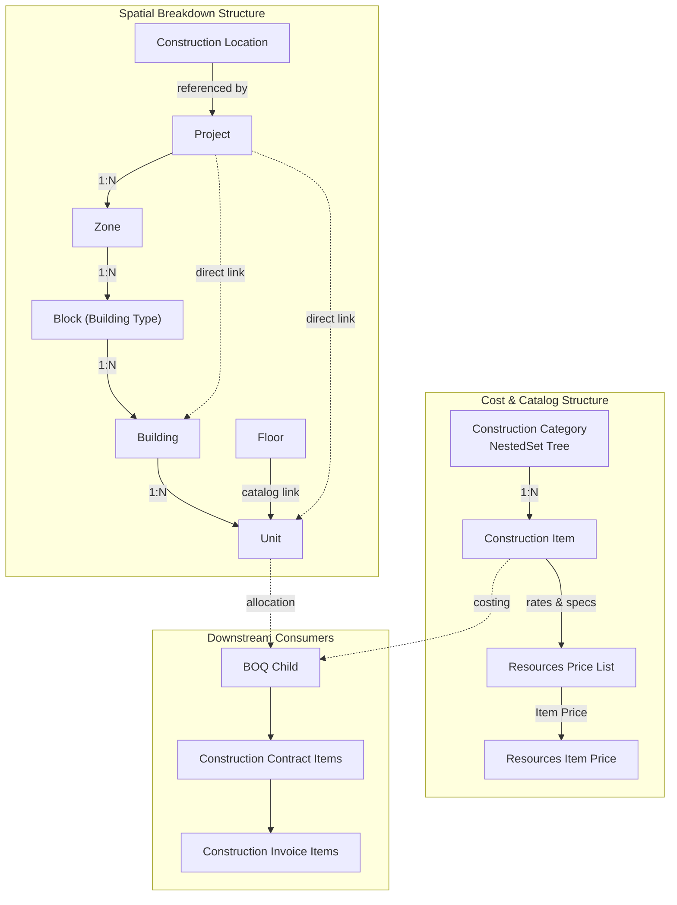
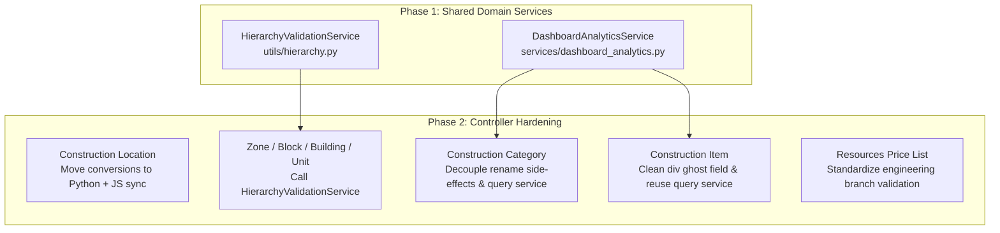

# Fabrica Construction: Codebase Design & Architecture Discovery

## 1. Executive Summary

This architecture and codebase design discovery analyzes the 10 foundational DocTypes of **Fabrica Construction**:
1. **Construction Location**
2. **Project** (ERPNext core integration)
3. **Zone**
4. **Block** (implemented as `Building Type`)
5. **Building**
6. **Floor**
7. **Unit**
8. **Construction Category**
9. **Construction Item**
10. **Resources Price List**

These DocTypes split into two core structural domains:
- **Spatial / Project Hierarchy Domain** (Location &rarr; Project &rarr; Zone &rarr; Block &rarr; Building &rarr; Floor &rarr; Unit)
- **Cost, Catalog & Work Breakdown Domain** (Construction Category &rarr; Construction Item &rarr; Resources Price List)

---

## 2. Domain Model & Spatial Hierarchy

---

## 3. Deep Analysis per DocType

### A. Spatial Hierarchy Group

| DocType | Implementation File | Current State | Codebase Design Evaluation |
|---|---|---|---|
| **Construction Location** | `construction_location.py` `construction_location.js` | Controller is `pass`. All land area conversions (Feddan, Qirat, Share, $m^2$) and $BUA$ formula live in JS. | **Shallow Module / Leaky Seam.** Invariants bypassed during REST API calls, CSV imports, and backend scripts. |
| **Project** | `override/project.py` `custom/project.json` | Extends ERPNext dashboard data; custom field `location` links to Construction Location. | **Clean Seam.** Non-invasive integration using standard dashboard hook and custom field metadata. |
| **Zone** | `zone.py` `zone.js` | Autoname `format:{zone_id}-{project}`. Python validates `zone_id` uniqueness per project. | **Good Locality.** Small interface, concise invariant. JS handles hierarchy dropdown cascading. |
| **Block (`Building Type`)** | `building_type.py` `building_type.js` | Labeled "Block Code" in UI, named `Building Type` in schema. Runs 2 separate queries for zone and project uniqueness. | **Naming Dissonance & Redundant DB Queries.** Schema name conflicts with business model. Variable name `filter` shadows Python builtin. |
| **Building** | `building.py` `building.js` | Controller is `pass`. Autoname `format:{code}-{project}`. Links to Block (`building_type`), Zone, Project. | **Shallow Module.** No server-side integrity validation. Hierarchy consistency checked only in client JS. |
| **Floor** | `floor.py` `floor.js` | Controller is `pass`. Master dictionary of floor numbers (`floor_number` unique). | **Appropriate Depth.** Acts as a simple reference master table. |
| **Unit** | `unit.py` `unit.js` | Controller is `pass`. Autoname `format:{unit_id}-{crm_id}`. Multiple area fields and CRM linkage. | **Typo & Missing Server Invariant.** Link field misspelled as `unite_type`. Server allows saving mismatched Project/Zone/Block/Building. |

### B. Catalog & Cost Breakdown Group

| DocType | Implementation File | Current State | Codebase Design Evaluation |
|---|---|---|---|
| **Construction Category** | `construction_category.py` `construction_category.js` | Extends `NestedSet`. Generates hierarchical `DIV 01.01` numbering. Re-names subtrees in `on_update`. CTE dashboard queries. | **Deep but Over-Coupled.** Heavy side effects on save (`rename_doc` during `on_update`). Mixed concerns: Tree structure, string numbering, financial reporting CTEs, custom treeview APIs. |
| **Construction Item** | `construction_item.py` `construction_item.js` | Autonamed by task number (`get_tree_number_for_construction_item`). Validates duplicate items and company defaults. Duplicates category CTE queries. | **DRY Violation & Ghost Field.** Dashboard queries are 100% duplicate of `construction_category.py`. Attempts to set `self.div` which is absent from schema. Raw SQL string formatting. |
| **Resources Price List** | `resources_price_list.py` `resources_price_list.js` | Controller is `pass`. Base master for resource rates. Overridden in Aljar System to enforce `engineering_branch`. | **Fragile Seam.** Aljar completely overrides `validate()` without `super()`, breaking extensibility. |

---

## 4. Key Architectural Findings & Deficiencies

### 1. Invariant Asymmetry (Client vs Server)
- **Problem**: Critical formulas and validations are placed solely in client-side JavaScript:
  - `Construction Location`: Unit conversions (Feddan $\leftrightarrow$ Qirat $\leftrightarrow$ Share $\leftrightarrow$ $m^2$) and Authorized BUA calculation exist only in `construction_location.js`.
  - `Building` and `Unit`: Child-to-parent consistency (e.g. Unit's Building must belong to Unit's Zone and Project) is filtered in Desk UI (`hierarchy_utils.js`), but completely missing in `Unit.validate()` or `Building.validate()`.
- **Consequence**: Data imported via Data Import, created via REST API, or created by automated integrations (e.g., `UploadProjectMasterPlan`) can violate hierarchy integrity silently.

### 2. Duplication of Complex Query Logic (DRY & Seam Failure)
- **Problem**: `get_dashboard_info` and `get_general_query_for_dashboard_info` in `construction_item.py` are identical copies of the CTE queries in `construction_category.py`.
- **Consequence**: Bug fixes or changes to fiscal year queries, currency handling, or document statuses must be maintained in duplicate.

### 3. High-Risk Side Effects in `ConstructionCategory.on_update`
- **Problem**: Renaming a DocType instance (`rename_doc` or `self.rename(..., force=True)`) during `on_update` when its parent or hierarchy changes is dangerous.
- **Consequence**: In Frappe, renaming a document while inside a transaction alters database foreign keys across thousands of child records (`boq_child`, `construction_contract_items`, `variation_order_items`), triggering database locking, table locks, and potential deadlock timeouts.

### 4. Semantic & Schema Divergence (Block vs Building Type, `unite_type`)
- **Problem**:
  - The DocType is named `Building Type`, but the field is labeled "Block Code", and business users treat it as "Block".
  - Field `unite_type` on `Unit` contains a typo (`unite_type` instead of `unit_type`).
  - In `construction_item.py`, `validate_category_and_div` attempts `self.set("div", ...)`, but `div` is not a field in the DocType schema.

### 5. Fragile Inheritance Seam in `ResourcesPriceList`
- **Problem**: `aljar_system` defines `AljarResourcesPriceList` which overrides `validate()` without calling `super().validate()`.
- **Consequence**: If `fabrica_construction` introduces core validations, they are silently ignored when Aljar is installed.

---

## 5. Refactoring Plan (Deep Module Architecture)

Following the principles of **codebase-design** (Small Interface, Deep Implementation, Clear Seams, High Locality):

### Phase 1: Establish Shared Domain Services (Deep Implementations)
1. **`HierarchyValidationService` (`fabrica_construction/services/hierarchy.py`)**:
   - **Interface**:
     - `validate_structure(doc, levels: list[str]) -> None`
     - `get_valid_ancestors(doctype, name) -> dict`
   - **Responsibility**: Validate in Python that any document linking Project, Zone, Block, Building, Unit maintains tree integrity (e.g. Building $\in$ Zone $\in$ Project).
   - **Benefit**: Reused by `Zone`, `Building Type`, `Building`, `Unit`, and child tables (`boq_child`, `construction_contract_items`).

2. **`ConstructionAnalyticsService` (`fabrica_construction/services/analytics.py`)**:
   - **Interface**:
     - `get_category_or_item_dashboard_summary(doctype, name) -> list[dict]`
   - **Responsibility**: Encapsulate the CTE QueryBuilder logic for contracted vs invoiced amounts across fiscal years.
   - **Benefit**: Eliminates duplicate CTE queries between `construction_category.py` and `construction_item.py`.

### Phase 2: Invariant Locality & Controller Cleanups
1. **Construction Location**:
   - Move land area unit conversion ratios into a shared Python utility (`fabrica_construction/utils/area_conversion.py`) and call it in `before_save()` as well as in JS on change.
2. **Block (`Building Type`)**:
   - Merge `validate_unique_block_code_per_zone` and `validate_unique_type_field_over_project` into a single query with clean parameter naming (replace `filter` with `filters`).
3. **Construction Item**:
   - Remove dead reference to `self.div` in `validate_category_and_div`.
   - Delegate dashboard query to `ConstructionAnalyticsService`.
   - Parameterize and sanitize task number extraction query.
4. **Construction Category**:
   - Isolate tree-renaming logic into an explicit maintenance action or preflight check rather than an automatic `on_update` hook that risks database deadlocks.
5. **Resources Price List**:
   - Add core validation or property setting for `engineering_branch` in `fabrica_construction` so that downstream apps (`aljar_system`) do not need to replace the entire controller class.

---

## 6. Verification & Test Strategy
- **Unit & Integration Tests**:
  - Test valid and invalid hierarchy chains on `Unit` and `Building` saves (Python API).
  - Test land area conversions in `Construction Location` via Python document insert.
  - Verify `Construction Category` and `Construction Item` dashboard queries return identical results before and after extracting the query service.
- **Regression Verification**:
  - Ensure compatibility with downstream forms (`boq_child`, `construction_contract_items`, `variation_order_items`).
  - Verify `aljar_system` controller overrides remain compatible without breaking changes.
