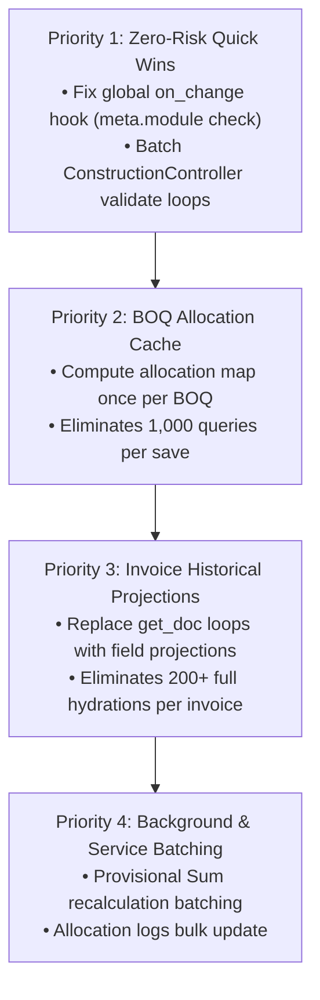

# Fabrica Construction: N+1 Query Problems Discovery & Analysis

## 1. Executive Summary

A comprehensive AST-based and call-graph analysis of `fabrica_construction` identified **313 database queries executed inside loops** across controllers, child tables, services, and reports. 

These N+1 query patterns fall into four critical architectural tiers:
1. **Full Document Hydration in Loops (`frappe.get_doc`)** — Hydrating entire documents with child tables inside loops.
2. **Whole-Table Aggregation Inside Child-Row Loops** — Re-aggregating the entire parent document's transactions for every single child row.
3. **Repetitive Point Lookups in Validations (`frappe.db.get_value` / `exists`)** — Validating collections of foreign keys one by one.
4. **Macro-Level N+1 in APIs and Global Hooks** — Calling entire script reports/external APIs per project, or querying database metadata on every system event.

---

## 2. Top N+1 Hotspots by Impact & Query Volume

| Hotspot / File | Loop Context | Loop Call | Severity | Impact at Scale |
|---|---|---|---|---|
| **`construction_invoice.py:681-773`** | `for contract in self.construction_contracts:` &rarr; `for invoice in contract.invoices:` | `frappe.get_doc(...)` | **Critical** | **O(Contracts × Invoices)** full doc hydrations. For 10 contracts with 20 invoices each = 200+ full doc loads per form open/save. |
| **`boq_child.py:125`** | `for row in boq.items:` &rarr; `row.get_contracted_qty()` | `get_boq_contracted_quantities(self.parent)` | **Critical** | **O(N)** whole-table grouped SQL queries. A 500-item BOQ runs **1,000 identical aggregate queries** during validation and total calculation. |
| **`provisional_sum.py:192` (`refresh_boq`)** | `for resource in boq.boq_items_resources:` & `for child in boq.bill_of_quantity:` | `resource.get_contracted_qty()` + `resource.save()` + `child.db_update()` | **High** | **O(R × (R + N))** updates. Each resource save fires `on_change`, triggering recursive child scans and redundant `db_update` loops. |
| **`api.py:305` (`get_projects_summary`)** | `for project in projects:` | `execute(project_filters)` (calls script report + external CRM) | **High** | **O(Projects)** full report runs + synchronous CRM HTTP calls (15s timeout each) just to get `closing_balance`. |
| **`utils/data.py:163` (`save_custom_version_for_doctype`)** | Global hook `*: {"on_change": ...}` | `frappe.get_all("DocType", {"module": "Fabrica Construction"})` | **High** | **O(1) query per document save in the entire bench** (including non-construction DocTypes and Versions). |
| **`construction_controller.py:182, 204`** | `for boq in boq_set:` / `for contract in contract_set:` | `frappe.db.exists()` + `frappe.db.get_value()` | **Medium** | **2N queries** per validation call instead of a single batched query with `name IN (...)`. |
| **`construction_contract.py:4254`** | `for payment_request in payment_requests:` | `frappe.db.get_value()` + `frappe.get_doc()` + `frappe.db.set_value()` | **Medium** | **3N queries** per contract payment sync. |
| **`purchase_receipt_allocation_logs.py:64`** | For every inserted log record | `frappe.get_doc(parent_doctype, parent_name)` + `.save()` | **Medium** | **O(M × N)** source row updates. Rewrites entire Purchase Order/Receipt for each individual log. |

---

## 3. Detailed Breakdown of Primary Offenders

### 1. Construction Invoice: Historical Invariant Hydration
- **Locations**:
  - `ConstructionInvoice.base_previous_grand_total` ([line 678](file:///home/ahmed-khairy/Documents/Projects/Fabrica_Project/frappe-bench/apps/fabrica_construction/fabrica_construction/fabrica_construction/doctype/construction_invoice/construction_invoice.py#L678-L701))
  - `ConstructionInvoice.previous_grand_total` ([line 751](file:///home/ahmed-khairy/Documents/Projects/Fabrica_Project/frappe-bench/apps/fabrica_construction/fabrica_construction/fabrica_construction/doctype/construction_invoice/construction_invoice.py#L751-L773))
  - `ConstructionInvoice.outstanding_from_previous_invoices` ([line 776](file:///home/ahmed-khairy/Documents/Projects/Fabrica_Project/frappe-bench/apps/fabrica_construction/fabrica_construction/fabrica_construction/doctype/construction_invoice/construction_invoice.py#L776-L800))
- **Mechanism**:
  ```python
  for contract_name in self.construction_contracts:
      contract_doc = frappe.get_doc("Construction Contract", contract_name) # N queries
      for invoice_name in contract_doc.construction_invoices:
          invoice_doc = frappe.get_doc("Construction Invoice", invoice_name) # N * M queries
          if invoice_doc.creation <= self.creation:
              base_previous_grand_total += invoice_doc.base_grand_total
  ```
- **Remediation**:
  Replace document hydration with a single SQL / QueryBuilder query filtering by `parent IN (contracts)` and `creation <= current_creation`, projecting only `name`, `base_grand_total`, and `grand_total`.

---

### 2. BOQ Child: Repetitive Aggregation Per Row
- **Location**: [`boq_child.py:125-130`](file:///home/ahmed-khairy/Documents/Projects/Fabrica_Project/frappe-bench/apps/fabrica_construction/fabrica_construction/fabrica_construction/doctype/boq_child/boq_child.py#L125-L130)
- **Mechanism**:
  ```python
  def get_contracted_qty(self) -> float:
      # Executes a full SQL query joining Construction Contract Items and Variation Order
      # grouped by BOQ child reference for the entire BOQ!
      return get_boq_contracted_quantities(self.parent, "boq_child").get(self.name, 0.0)
  ```
- **Call Sites**:
  1. `boq.py:354`: `self.calculate_totals("get_contracted_qty")` loops over all rows ($N$ queries).
  2. `boq_child.py:73`: `self.contracted_qty = self.get_contracted_qty()` on every child validation ($N$ queries).
- **Remediation**:
  Build the contracted quantities dictionary once at the `BOQ` parent level (`boq._contracted_quantities_map = get_boq_contracted_quantities(self.name, "boq_child")`) and pass or look up from memory in child rows.

---

### 3. Global `on_change` Hook Querying Bench Metadata
- **Location**: [`utils/data.py:163`](file:///home/ahmed-khairy/Documents/Projects/Fabrica_Project/frappe-bench/apps/fabrica_construction/fabrica_construction/utils/data.py#L163-L171) & [`hooks.py:212`](file:///home/ahmed-khairy/Documents/Projects/Fabrica_Project/frappe-bench/apps/fabrica_construction/fabrica_construction/hooks.py#L212)
- **Mechanism**:
  `hooks.py` registers `save_custom_version_for_doctype` on `"*": {"on_change": ...}`.
  On every document save in the entire ERP:
  ```python
  fabrica_construction_doctypes = frappe.get_all("DocType", filters={"module": "Fabrica Construction"}, pluck="name")
  if doc.doctype not in fabrica_construction_doctypes:
      return
  ```
- **Remediation**:
  Replace `frappe.get_all` with in-memory metadata inspection:
  ```python
  if frappe.get_meta(doc.doctype).module != "Fabrica Construction":
      return
  ```
  This immediately eliminates thousands of unnecessary queries across the system without affecting functionality.

---

### 4. Validation Collections in `ConstructionController`
- **Location**: [`controllers/construction_controller.py:180-215`](file:///home/ahmed-khairy/Documents/Projects/Fabrica_Project/frappe-bench/apps/fabrica_construction/fabrica_construction/controllers/construction_controller.py#L180-L215)
- **Mechanism**:
  Loops over sets of BOQs and Contracts, executing individual `frappe.db.exists` and `frappe.db.get_value` calls per item.
- **Remediation**:
  Batch fetch all referenced documents in a single query:
  ```python
  boq_data = frappe.get_all("BOQ", filters={"name": ["in", list(boq_set)]}, fields=["name", "company", "docstatus"])
  ```

---

## 4. Remediation Priority Roadmap



1. **Phase 1 (Instant system-wide relief)**:
   - Fix `save_custom_version_for_doctype` to use cached `frappe.get_meta(doc.doctype).module`.
   - Batch `validate_linked_boq_with_doctypes` and `validate_linked_construction_contract_with_doctypes`.
2. **Phase 2 (High-volume transaction relief)**:
   - Cache `get_boq_contracted_quantities` across `BOQ` total calculations and row validations.
3. **Phase 3 (Heavy invoice serialization relief)**:
   - Refactor `base_previous_grand_total` and `previous_grand_total` in `ConstructionInvoice` to use a single batched query instead of nested `frappe.get_doc` calls.
